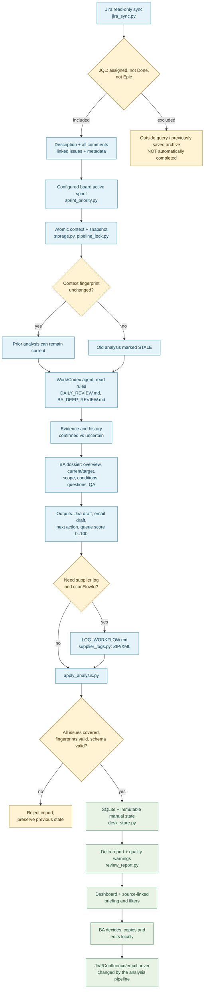
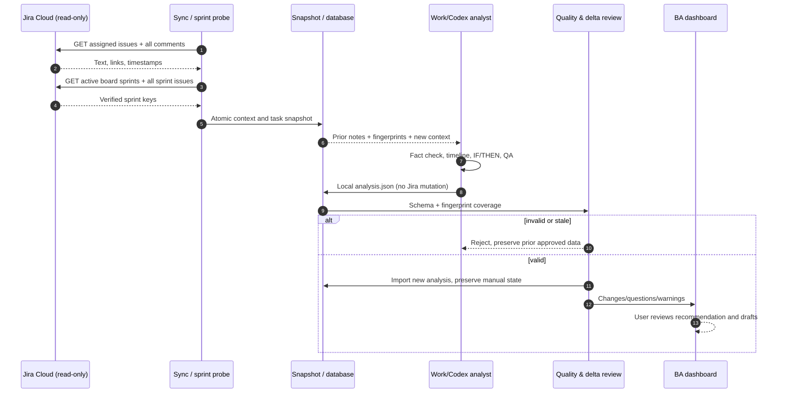
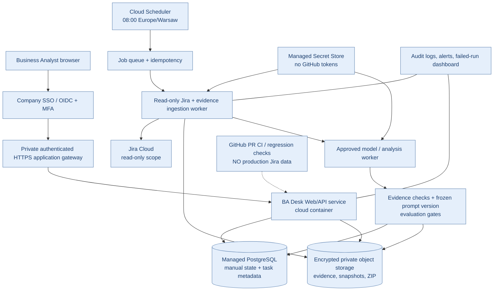
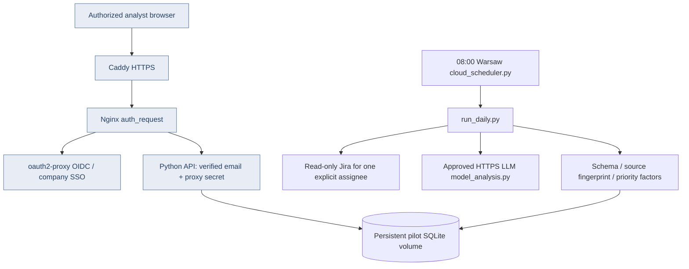

# CCON BA Desk: функціональна архітектура та потік однієї задачі

Статус: 2026-10-24. **Суцільні вузли = реалізовано в PR-гілці**,
**пунктирні = цільова хмарна архітектура (ще не розгорнута)**.
Цей документ описує функції коду, а не гарантує фактичний доступ до Jira,
логів, Work/Codex або корпоративної хмари.

## 1. Повний task lifecycle (фактичний)

**Important distinction:** the dashboard lets the user manually save local
status/notes/edited drafts, and Outlook actions can open mailto drafts.
Neither is an automatic Jira write, but the latter is Windows-specific
and not suitable as the cloud outbound-mail pattern.

### Important scope boundary

The current JQL filters `assignee = currentUser()`. Active sprint
membership is fetched from the authoritative board, but **only
assigned issues already in this JQL** become analyzed task cards.
A future all-sprint/team queue must be an explicit product decision
and not inferred from verified membership alone.

## 2. Module catalogue and ownership

| Module | Current job | Input/output | Cloud or product decision |
| --- | --- | --- | --- |
| `jira_sync.py` | Jira API search, pagination, comments, dependencies, stale fingerprint | Jira → context/snapshot JSON | Keep; split fetch and source-normalization; read-only OAuth/secret |
| `sprint_priority.py` | Board-specific verified active sprint membership | Jira Software Agile → per-task lane | Keep; configure `CCON_JIRA_BOARD_ID` or local `.jira-board.json` |
| `configure_jira.py` | Interactive Windows Jira credential setup | DPAPI local secret | Legacy only; cloud must use managed secret |
| `ROVO_PROMPT.txt` | Manual alternate snapshot creation | Rovo → inbox JSON | Deprecate as primary; retain explicit offline fallback |
| `DAILY_REVIEW.md` | Work/Codex orchestration instructions | source + rules → analysis | Keep until cloud worker replaces Work dependency |
| `DAILY_AUTOMATION_PROMPT.md` | Existing scheduled task prompt | local agent instruction | Keep as legacy adapter; cloud schedule separate |
| `BA_ANALYSIS_RULES.md` | Factual review / unresolved questions | Jira context → rationale | Keep as controlled rules |
| `BA_DEEP_REVIEW.md` | Dossier, provenance, IF/THEN, readiness | evidence → `briefing` | Keep with grounded evaluations |
| `TASK_DESCRIPTION_RULES.md` | English CCON Task description | verified rules → draft | Keep; acceptance traceability |
| `EMAIL_RULES.md`, `email_rules.py` | Compose/normalize supplier drafts | analysis + verified method → draft | Keep drafting only; no automatic send |
| `LOG_WORKFLOW.md`, `supplier_logs.py` | Find cconFlowId, sanitize/inspect XML, archive | referenced flow + authorized ZIP → local archives | Separate background evidence worker; encrypted object storage |
| `log_attachments.py` | Validate ZIP integrity, serve/download, Windows folder | logs index → task assets | Keep download; remove Windows folder opener from cloud |
| `apply_analysis.py` | Coverage/fingerprint/shape validation + import | analysis JSON → task snapshot | Keep and expand quality gates |
| `ba_briefing.py` | Structured briefing shape and diagnostic warnings | analysis.briefing → checks | Keep; validate sources semantically using human eval |
| `review_report.py` | Daily task/question changes and warnings | previous + current → delta JSON | Keep, improve actual Jira Done tracking |
| `desk_store.py` | SQLite manual status, notes, drafts, task cache | snapshot ↔ DB | Keep interface; migrate storage to PostgreSQL for cloud |
| `schema.py` | Validation types, score range 0–100, safe URLs | payload → validated | Keep |
| `storage.py`, `pipeline_lock.py` | Atomic JSON and cross-process lock | local files | Replace in cloud with transaction/lease/object store |
| `server.py` | Localhost HTML, JSON API, manual saves, attachment download | browser ↔ local files | Rewrite auth/storage boundaries before internet exposure |
| `dashboard.html`, `assets/dashboard.mjs` | BA queue, detail, briefing, local forms and mailto | API → browser | Keep UI concept; cloud auth, role checks, autosave |
| `assets/task-rules.mjs` | Pure sorting, signals, filtering and manual overrides | task objects → ordered tasks | Keep sprint-first rule with tests |
| `assets/logs.mjs` | Log status/update client | task ZIP catalog | Keep download pattern |
| `assets/dashboard.css` | UI/theme | design tokens | Use AERTiCKET-inspired brand tokens pending official sign-off |
| `evaluation.py` | Local 20–30 real-case human quality evaluation | frozen context + A/B ratings → metrics | Keep data off public GitHub |
| `app_config.py` | Shared constants/paths/version | runtime config | Cloud configuration must be environment-based |
| `Start CCON BA.bat` | Windows launcher | local shell | Legacy only; remove from cloud deployment image |
| `build_release.py`, `release_manifest.json` | Local ZIP release packaging | source → ZIP | Keep for Windows fallback only |
| `check_project.py`, `tests/`, `.github/workflows/quality.yml` | Regression, syntax, independent release checks | PR → pass/fail | Keep; mandatory PR check + cloud security checks |

## 3. One-task interactions (sequence)

## 4. Target cloud architecture (NOT IMPLEMENTED)

Cloud deployment **requires an approved corporate infrastructure account,
SSO tenant, runtime model access, data-retention policy and Jira read-only credentials**.
The existing 127.0.0.1 server has no remote user authentication and cannot
safely be publicly exposed or served by GitHub Pages alone.

## 5. Product removal / refactoring plan

| Decision | Module / feature | Why |
| --- | --- | --- |
| KEEP | Jira read-only sync, QA dossier, source references | Core analyst value |
| KEEP + HARDEN | Per-task delta report and quality warnings | Must not mistake leaving JQL for Jira Done |
| KEEP + PRIORITIZE | Active sprint lane and 0–100 score | Scrum scope outranks every backlog score |
| REWORK | Old shared flat priority, stale state, previous manual choices | Need explicit sprint and completion provenance |
| REWORK | Work/Codex dependency | Cloud worker needs approved model runtime, retries, stable prompt version |
| REWORK | Prompt self-improvement | Daily suggestions + bounded adaptive checklist, validated promotion only |
| REWORK | Local SQLite and ZIP | Multi-device private cloud needs transactions, encryption, backups |
| REMOVE FROM CLOUD (KEEP LEGACY) | `Start CCON BA.bat`, Windows folder opener, DPAPI file | Windows-specific |
| REMOVE FROM CLOUD (KEEP FALLBACK) | Rovo manual JSON snapshot | Duplicate source of truth vs Jira read-only sync |
| REMOVE FROM CLOUD | Bulk mailto Outlook launch | Not a safe cloud-native draft synchronization mechanism |
| ADD | OAuth/SSO, role restrictions, tenant/user isolation | Internet-accessible task/context data |
| ADD | State transition audit, Jira Done verification, run health | No silent false completions or missing data |
| ADD | Versioned prompt experiments and approval gate | Avoid daily degradation and unsupported assertions |
| ADD | Design system and accessible cloud UI | Consistency with approved corporate identity |

## 6. Business decisions still required

1. Which Jira board ID is authoritative for sprint priority? An issue can exist
   in past/future sprints and several boards: the configured board is the source
   of truth, not the raw Sprint custom field.
2. Is cloud hosting allowed for full supplier XML and employee correspondence?
   Decide access policy, audit, EU data storage/retention and model provider.
3. Can the BA assistant use an approved model API in the cloud, rather than
   relying on the current local Work/Codex automation?
4. Is the source-of-truth brand guide available? Public blue/charcoal palette
   may be imitated, but official brand compliance needs an approved kit.

For Jira Software Cloud sprint REST reference see:
https://developer.atlassian.com/cloud/jira/software/rest/api-group-board/

## 7. Private one-analyst cloud pilot (v2.6 code)

Code exists in the PR branch; this topology is **not deployed**
on a corporate cloud. SQLite is a single-user pilot only.
Managed PostgreSQL, HA, approved object storage, backup/restore and
company OIDC credentials remain external prerequisites.
