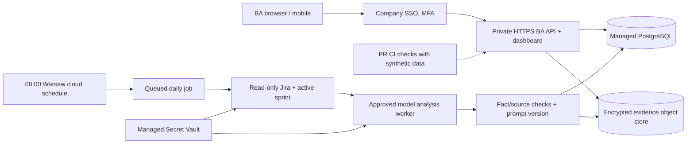

# ADR: secure cloud migration of CCON BA Desk

**Status:** Proposed / deployment not executed  
**As-of:** 2026-10-24  
**Decision:** User wants private web access from any device, persistent state and scheduled AI analysis.
The current 127.0.0.1 + Windows DPAPI + SQLite implementation **is not cloud deployable as-is**.
Do not expose port 8765 to the internet or deploy private Jira payloads with GitHub Pages.

## Verified repository/security baseline

At audit time `slyvchenko/ccon-ba-task-tracker` has GitHub
visibility **public**. Source code may remain public with permission,
but do not commit corporate Jira payloads, company secrets, private
supplier evidence, customer PNRs or individual employee notes.
For a company deployment evaluate private repository access,
history scanning, secret scanning, protected environments and permission
to host company data. Making the repository private alone does not
remove already-exposed material from history.

Hosting needs an approved company tenant; **no live cloud URL is
currently deployed** and GitHub Pages would not meet the security/storage
requirements.

## Target product

- Private HTTPS URL after company SSO login, accessible from browser/phone.
- Active verified Jira board sprint is the top workload; backlog stays 0–100 scoped queue.
- Read-only Jira, source documents and logs. Never write to Jira/Confluence,
  never automatically send supplier email.
- Persistent personal BA notes, task revisions and drafts across sessions.
- Run daily at **08:00 Europe/Warsaw** even if the user's laptop is off.
- Clear status of refresh, errors, incomplete evidence and whether the agent ran.
- Store prompts, their versions, evaluations, and safe daily adaptive checklist changes.
- AERTiCKET-approved corporate style and access policy.

## Recommended generic architecture

1. **SSO gateway** using corporate OIDC / Entra ID or other approved identity
   provider with MFA. Enforce authentication at the reverse proxy AND API.
2. **Cloud application** in a managed private container runtime (Cloud Run,
   Azure Container Apps, or company-hosted Kubernetes) serving HTML + API.
   Configure HTTPS, safe forwarded-host handling, CSRF defenses, session renewal,
   rate limits, CSP and access logging. Do not reuse the localhost Host/Origin
   checks as cloud security controls.
3. **Managed PostgreSQL** (encrypted, private network) replaces SQLite.
   Preserve manual status, notes and drafted text through transaction-safe
   migrations; tenant/user ownership should be explicit on every row.
4. **Object storage** with private access, encryption and retention policy for
   snapshots, logs, reports and attachment ZIPs. Per-task download must verify
   user authorization, content hash and short-lived access.
5. **Scheduled ingestion worker** using Europe/Warsaw-aware scheduler and
   queue/locks. Read-only Jira integration, sprint endpoint, incremental
   fetching, failure retries and run logs. Handle daylight saving changes.
6. **Approved model worker** with organization-accepted API/provider and data
   processing agreement. It must use frozen prompt versions, sanitized source
   text and source-grounded validation. The current interactive Work/Codex
   automation cannot be assumed to run on an unattended cloud server.
7. **Secret storage** using cloud secret manager and least-privilege read-only
   Jira credentials/OAuth. Never store secrets or real corp Jira payloads
   in public GitHub repository, CI artifacts or client-side JavaScript.
8. **Monitoring and recovery**: error rate, stale-sync alert, Jira/LLM API
   budget, task count, sprint membership status, failed evidence reads,
   backup+restore and audit events.

## Migration diagram

## Suggested phased delivery

| Phase | Deliverable | Acceptance / hard gate |
|---|---|---|
| C0 | Security and provider decision | Corporate permission for hosted Jira, logs, AI analysis, data retention and region |
| C1 | Cloud authentication & storage | SSO MFA, per-user isolation, PostgreSQL migrations, private file storage, no public data |
| C2 | Read-only scheduled worker | Jira sync & active sprint at 08:00 Europe/Warsaw with idempotency and retries |
| C3 | Model analysis with provenance | End-to-end dossiers, quality checks, versioned prompts; no external write endpoints |
| C4 | Cloud UI and monitoring | Private URL; mobile responsive; cross-device manual notes; health/last success |
| C5 | Pilot + rollback | 20–30 reviewed cases, zero critical false claims, measured human time savings, restore tested |

## Design trade-offs

- **Provider**: use employer-approved infrastructure rather than choosing a
  public service based solely on convenience. Azure + Entra is natural for
  Microsoft-centric organizations; GCP + IAP is viable for GCP organizations.
- **Database**: SQLite on one ephemeral container is unsuitable for scale,
  concurrent users and persistent cloud revisions. Prefer PostgreSQL migration,
  not a mounted local ZIP backup.
- **Prompts**: daily adaptive notes are safe to auto-refresh from diagnostic codes.
  Do not silently rewrite and deploy untested core instructions. Promote a
  candidate only after regression and real-case human evaluation.
- **Email**: opening Windows mailto windows and folders has no universal cloud
  equivalent. Keep copyable drafts; an eventual Outlook integration requires
  scope and explicit user consent.
- **Model**: interactive Work execution is not a cloud runtime contract.
  Select an approved API/provider and secure secrets before calling this
  a cloud autonomous agent.
- **Public repository**: code may stay public but hosting configuration must
  never include Jira tokens, serialized customer itineraries, email addresses
  or supplier response logs.

## Definition of cloud-ready

- [ ] Company SSO login is enforced; unauthenticated API, files and health
      endpoints disclose no private data.
- [ ] End-to-end HTTPS URL reachable from another device, not only localhost.
- [ ] Worker succeeds when laptop is off, and failure is visible in the UI.
- [ ] Data survives container restart/deployment and DB point-in-time restore.
- [ ] Sprint membership matches a configured board and is fresh.
- [ ] Jira/Confluence integrations are read-only; outgoing email not sent.
- [ ] Tokens stored in vault; audit logs show no leaked secrets.
- [ ] Real-case source-grounded regression benchmark reviewed by a human.
- [ ] Private and accessible AERTiCKET-approved UI.

## What is needed to start cloud deployment

1. Approved cloud account/project/subscription + region, billing and permission
   to create managed services.
2. Corporate identity provider configuration / group for authorized users.
3. Read-only Jira service credentials/OAuth with sprint-board permissions,
   plus the authoritative CCON Jira board ID.
4. Approved hosted model service/API, company AI data policy.
5. Corporate retention and evidence/log storage decision.

Until these exist, **do not claim a live cloud deployment**.
